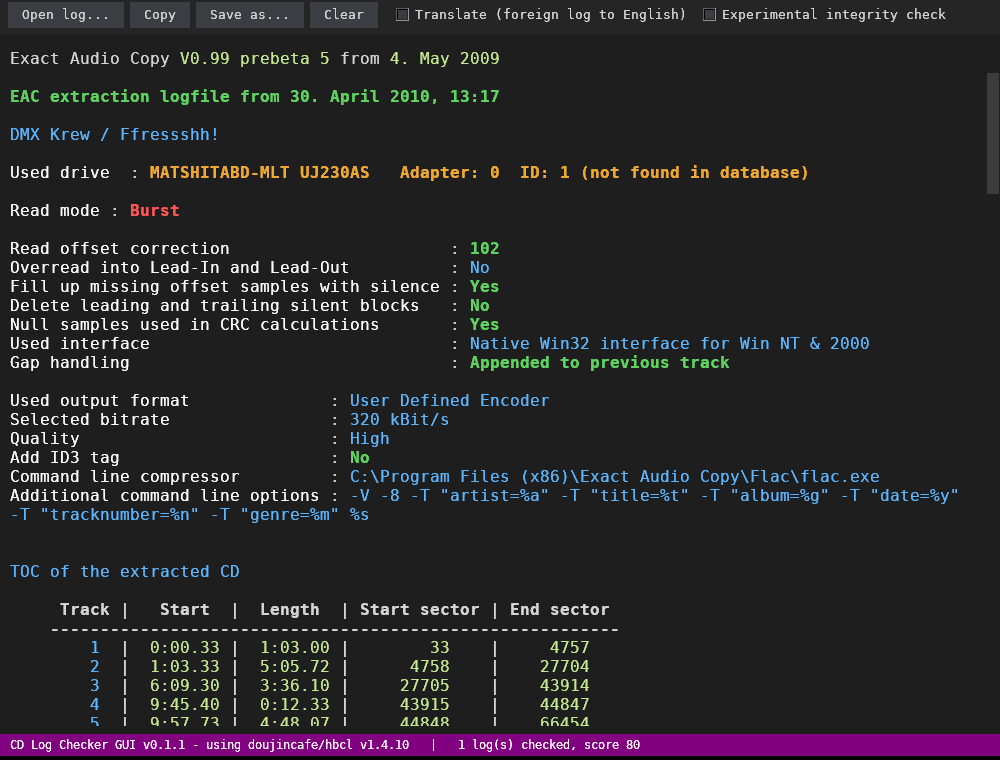

# CD Log Checker GUI

**A portable Windows desktop app for checking CD rip logs, built on
[hbcl (hey-bro-check-log)](https://github.com/doujincafe/hbcl).**

CD Log Checker GUI puts a simple window on top of hbcl, the EAC / XLD rip log
checker. Drop a log file onto the window and you get the score, the list of
deductions, and the full log with color coding, so bad settings and rip errors
stand out right away. It is portable: unzip it and run, with nothing to install.



## Features

- **Scores EAC and XLD logs** using hbcl's rules, including old EAC 0.95 logs,
  foreign-language EAC logs and combined logs.
- **Lists deductions** with the points each one costs.
- **Color-coded stylized log**: green for good settings and accurate rips,
  orange for warnings, red for problems, blue for neutral information.
- **Drag and drop** one or more `.log` files onto the window, or use
  **Open log...**. You can also drop a log onto the `.exe` icon.
- **Translate** foreign EAC logs to English.
- **Experimental integrity check** (EAC / XLD checksum verification, from hbcl).
- **Copy** the report to the clipboard, or **Save as...** plain text or colored HTML.
- **Portable**: no installer and no Python needed. Run it from any folder or a USB stick.
- Bad input (unrecognized logs, broken encodings, non-log files) is reported in
  the window; it does not crash the app.

## Download and use

1. Go to the [**Releases**](https://github.com/AgiLityOps/CD-Log-Checker-GUI/releases) page and download
   `CD-Log-Checker-GUI-vX.Y.Z-win64-folder.zip` from the latest release
2. Right-click the zip and choose **Extract All...**. Extract it anywhere you like
   (Desktop, Documents, a USB stick...). Make sure you extract **all** the files;
   don't run the exe from inside the zip.
3. Open the extracted `CD-Log-Checker-GUI` folder and double-click
   `CD-Log-Checker-GUI.exe` to open the program.
   - Keep the `_internal` folder next to the exe. The app needs it. To move the app,
     move the whole `CD-Log-Checker-GUI` folder.
   - Nothing is installed. To remove the app, delete the folder.
4. Drag a `.log` file from Explorer onto the window (or click **Open log...**).
5. Tick **Translate** or **Experimental integrity check** if you need them; the
   loaded logs are re-checked immediately.

Keyboard shortcuts: `Ctrl+O` open, `Ctrl+S` save, `Ctrl+A` select all, `Ctrl+C` copy selection.

## Want a single .exe?

Official releases ship the folder version only, because single-file PyInstaller
exes are much more likely to be flagged by antivirus programs as a false positive.
If you'd still like one self-contained `.exe`, you can build it yourself in a few
minutes, on your own PC or for free with GitHub Actions. Follow
**[Build a single .exe yourself](docs/BUILDING.md#build-a-single-exe-yourself)**.

## VirusTotal

The v0.1.2 release was scanned on VirusTotal on 21 November 2026 with no detections:

| File | Result | SHA-256 |
|---|---|---|
| [`CD-Log-Checker-GUI-v0.1.2-win64-folder.zip`](https://www.virustotal.com/gui/file/2a5073ca9b922525c0ca9d206a7c13fd0850d88a66a7c488cf33bb10ebc7cc58) (download) | **0 / 65** | `2a5073ca9b922525c0ca9d206a7c13fd0850d88a66a7c488cf33bb10ebc7cc58` |
| [`CD-Log-Checker-GUI.exe`](https://www.virustotal.com/gui/file/2cb6ffc8dd8bb48c60ad9dcbf7767d74233489b6468ad910be2dffa1174ef4dc) (inside the zip) | **0 / 71** | `2cb6ffc8dd8bb48c60ad9dcbf7767d74233489b6468ad910be2dffa1174ef4dc` |

## Building it yourself

See **[docs/BUILDING.md](docs/BUILDING.md)** for a step-by-step guide, written
for beginners. It covers:

- getting a ready-made build from GitHub Actions (no tools needed on your PC),
- building on your own Windows PC, as a folder or as a single `.exe`,
- moving to a newer version of hbcl,
- fixing common errors.

Quick version for developers (Windows, Python 3.12 or 3.13, Git installed):

```bat
python -m venv .venv
.venv\Scripts\activate
pip install -r requirements-build.txt
set HBCL_GUI_ONEDIR=1
pyinstaller --clean --noconfirm hbcl_gui.spec
```

The result is the folder `dist\CD-Log-Checker-GUI\`. Leave out
`set HBCL_GUI_ONEDIR=1` (in a new Command Prompt) to get a single
`dist\CD-Log-Checker-GUI.exe` instead. To run from source: `python run_hbcl_gui.py`.

## Credits and thanks

This app is only a window. **All of the log checking, scoring, translation and
integrity checking is done by hbcl**, and the credit for that belongs to the
people below. Thank you all for building and maintaining such a useful tool and
for releasing it as open source.

- **[ligh7s](https://github.com/ligh7s)**, author of the original
  [hey-bro-check-log](https://github.com/ligh7s/hey-bro-check-log), which hbcl
  grew from.
- **The doujin café Discord community**, who maintain
  [hbcl](https://github.com/doujincafe/hbcl) today. Thanks to the contributors
  to the doujincafe/hbcl repository:
  [@fumiichan](https://github.com/fumiichan),
  [@0x1f610](https://github.com/0x1f610),
  [@CetaceanNation](https://github.com/CetaceanNation),
  [@grigorescu](https://github.com/grigorescu),
  [@woshiluo](https://github.com/woshiluo) and
  [@justjakka](https://github.com/justjakka).
- **[puddly](https://github.com/puddly)**, whose
  [eac_logsigner](https://github.com/puddly/eac_logsigner) provides the EAC
  checksum check used by hbcl.
- **[OPSnet](https://github.com/OPSnet)**, whose
  [xld_logchecker.py](https://github.com/OPSnet/xld_logchecker.py) provides the
  XLD checksum check used by hbcl.

Drag and drop uses [tkinterdnd2](https://github.com/Eliav2/tkinterdnd2) and the
tkdnd extension. The exe is built with [PyInstaller](https://pyinstaller.org).

**This is an unofficial GUI.** It is not affiliated with, or endorsed by,
ligh7s, the doujin café community, the hbcl contributors, puddly or OPSnet.
Please report problems with this app here, not to the hbcl project.

## AI disclaimer

This project was built with the help of Grok, an AI assistant. The code was
AI-generated and then reviewed and tested by the maintainer. It is provided
"as is", without warranty of any kind. Use it at your own risk.

## Known issues

- **Windows SmartScreen.** The app isn't code-signed, so Windows may show
  "Windows protected your PC" the first time. Click **More info**, then **Run anyway**.
- **Antivirus.** Release builds use a PyInstaller bootloader compiled from
  source, no UPX, and the folder layout, which scanned clean (see
  [VirusTotal](#virustotal)). Single-file builds you make yourself are more
  likely to be flagged by mistake.
- **"Failed to load Python DLL" / missing files.** The exe was started without
  its `_internal` folder, or from inside the zip. Extract the whole zip and keep
  the folder together.
- hbcl's markup for some EAC 0.95 track headers is slightly malformed; the app
  repairs it before displaying it.

## License

Licensed under the [Apache License 2.0](LICENSE). See [NOTICE](NOTICE) for
attribution of hbcl (also Apache-2.0) and of the third-party components that
are bundled in the Windows exe.
